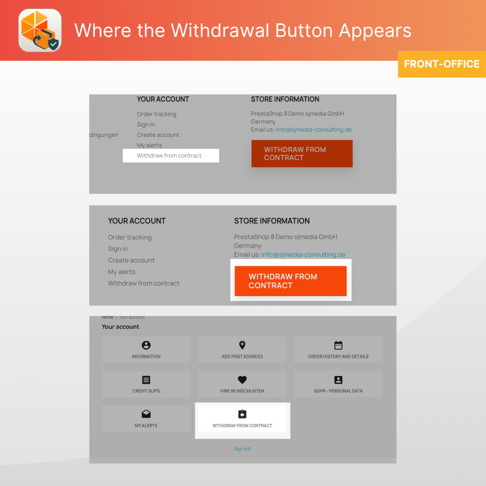
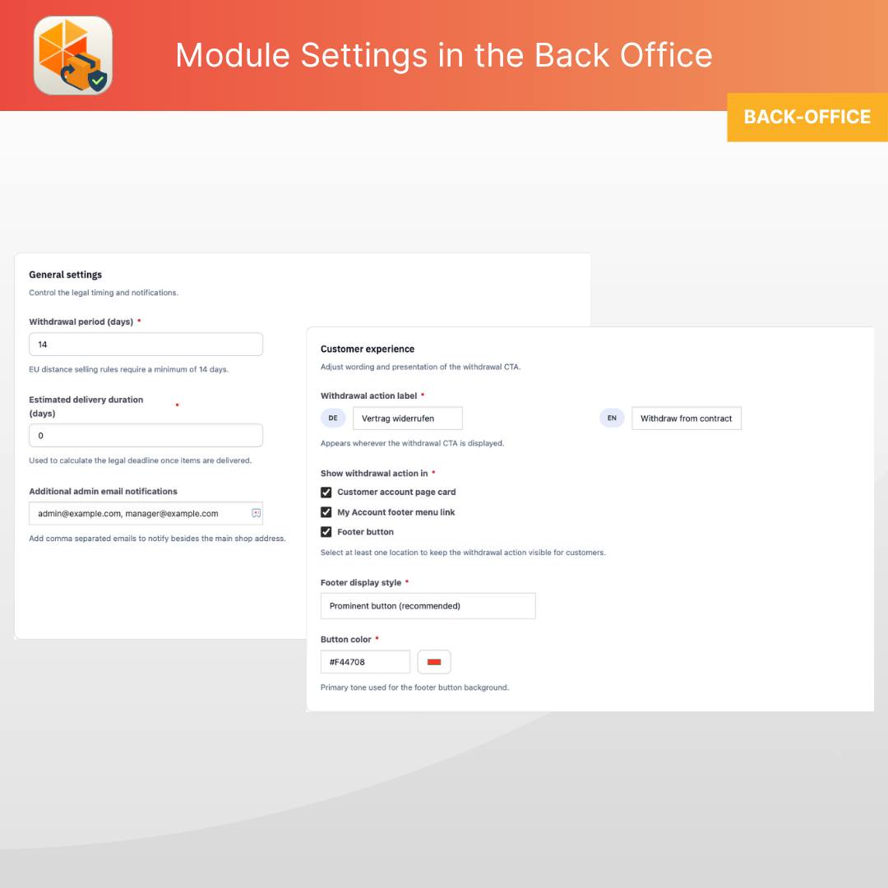
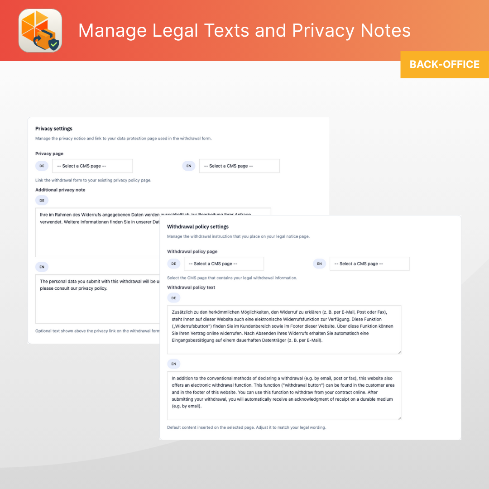
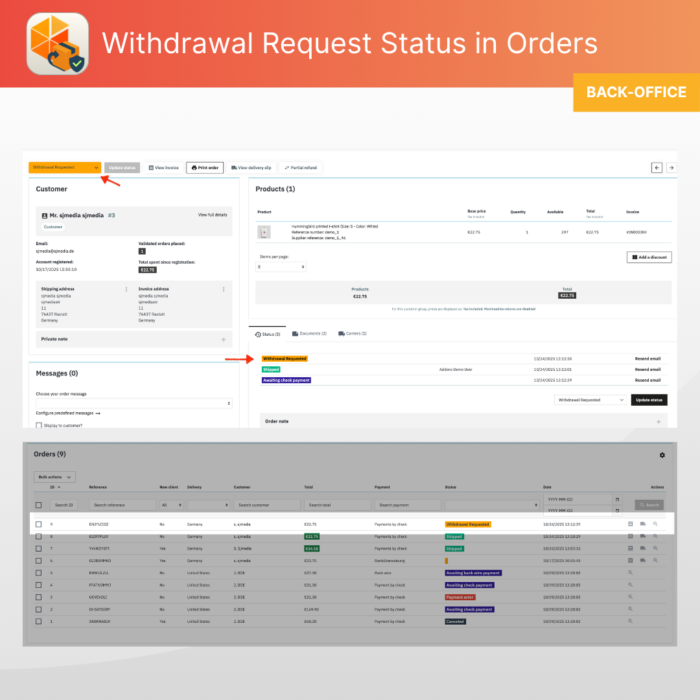
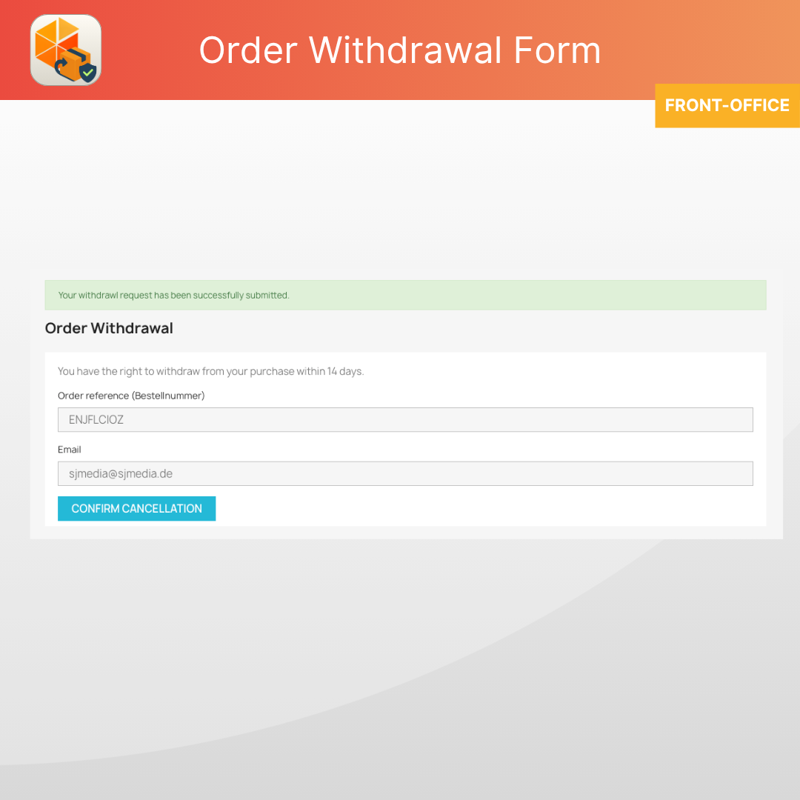

# Order Withdrawal Module for PrestaShop

## Overview

The Order Withdrawal Module enables your customers to easily and securely exercise their statutory right of withdrawal for orders in compliance with EU consumer protection laws. The module offers a user-friendly solution with multilingual support, automatic email notifications, and flexible display options.

### Key Benefits

- ✅ **EU Compliant** - Meets the requirements of EU Directive 2011/83/EU
- ✅ **Easy to Use** - Clear, intuitive forms for your customers
- ✅ **Automated Processes** - Status changes and email notifications happen automatically
- ✅ **Flexible Display** - Show withdrawal button in multiple locations simultaneously
- ✅ **Fully Multilingual** - Supports 8 languages out-of-the-box
- ✅ **Legally Secure** - Integrated privacy and withdrawal notices

## Features in Detail

### 1. Multiple Display Options

Display the withdrawal button in the locations that suit you best:

- **In Footer** - Prominent as a colored button or subtle as a text link
- **In Customer Account Menu** - For older PrestaShop 1.7 themes
- **On Customer Account Page** - Modern card display for PrestaShop 8/9

You can also activate multiple positions simultaneously, e.g., Footer + Customer Account Page.



### 2. Individual Customization

Adapt the module to your corporate design:

- **Free Choice of Button Color** - Hex color code for perfect brand alignment
- **Button or Link** - Choose between prominent button display or subtle text link
- **Individual Labels** - Define your own button texts per language



### 3. CMS Integration & Legal Notices

Connect the module with your legal pages:

#### Privacy Notice
- Link your privacy policy per language
- Add a custom privacy notice (e.g., "Your data will only be used to process the withdrawal")
- The notice is automatically displayed on the linked CMS page

#### Withdrawal Information
- Link your withdrawal policy per language
- Add a notice about the electronic withdrawal button
- Inform customers about automatic receipt confirmation via email



### 4. Automatic Order Status Management

- Automatically creates an order status **"Withdrawal Requested"** with orange marking
- Changes the order status immediately after successful withdrawal submission
- Enables easy filtering and management of all withdrawal requests



### 5. Intelligent Period Calculation

The module automatically calculates the withdrawal period:

- **Withdrawal Period** - Default: 14 days (according to EU directive)
- **Delivery Buffer** - Additional days for delivery time
- **Automatic Validation** - System checks if the period is still active

**Example:** With 14 days withdrawal period + 3 days delivery buffer = 17 days from order date

### 6. Dual Email System

#### Customer Confirmation
Your customers receive a confirmation email immediately after submission with:
- Configured order identifier (order ID, order number, or both)
- Email address
- Date and time of withdrawal submission
- Confirmation of receipt on a durable medium (according to EU law)

#### Administrator Notification
You and your staff receive a notification with:
- Configured order identifier plus order ID/order number tokens
- First and last name plus email address
- Order value
- Timestamp of withdrawal submission

You can register multiple email addresses (comma-separated) for notifications.

### 7. Multilingual Support

The module is fully translated for:
- 🇩🇪 Deutsch
- 🇬🇧 English
- 🇫🇷 Français
- 🇮🇹 Italiano
- 🇪🇸 Español
- 🇵🇱 Polski
- 🇳🇱 Nederlands
- 🇷🇴 Română

All texts, email templates, and button labels can be individually customized for each language.

## System Requirements

- **PrestaShop:** 1.7.8 or higher (tested with PrestaShop 8.x and 9.x)
- **PHP:** 7.4 or higher (PHP 8.x supported)
- **MySQL/MariaDB:** 5.6+ / 10.1+
- **SSL Certificate:** Recommended for secure form submission

## Installation

### Via PrestaShop Admin Panel (recommended)

1. Download the module ZIP file
2. Navigate to **Modules** → **Module Manager**
3. Click **Upload a module**
4. Select the ZIP file and upload it
5. Click **Install**

The module automatically creates during installation:
- Order status "Withdrawal Requested" (orange marking)
- Default configuration with 14 days withdrawal period
- All necessary email templates for 8 languages

### After Installation

1. Click **Configure** in the module
2. Check the withdrawal period (default: 14 days)
3. Enter additional delivery days if needed
4. Select where the withdrawal button should appear
5. Customize button color and text as desired
6. Link your CMS pages (privacy policy, withdrawal information)
7. Add the legal notice texts
8. Save the settings

## Configuration in Detail

### Basic Settings

| Setting | Description | Default |
|---------|-------------|---------|
| **Withdrawal Period (days)** | Legal withdrawal period | 14 days |
| **Estimated Delivery Time (days)** | Buffer for delivery time | 0 days |
| **Order Assignment Details** | Choose first and last name + order number, first and last name + order ID, first and last name + order ID or order number, or email + order ID or order number (older method, not recommended) | First and last name + order number (recommended) |
| **Evaluation Mode** | Manual review or automatic period check | Manual review |
| **Additional Admin Emails** | Additional recipients for notifications (comma-separated) | Empty |

### Display Options

| Setting | Options | Description |
|---------|---------|-------------|
| **Display Position** | Footer / Account Menu / Account Page | Multiple selection possible |
| **Footer Display** | Button / Link | Button is prominent, link is subtle |
| **Button Color** | Hex color code | Default: #F44708 (Orange) |

### Configurable Per Language

- **Button Label** - Individual text for the withdrawal button
- **Privacy Page** - Linked CMS page for privacy policy
- **Privacy Notice** - Notice text about data processing during withdrawal
- **Withdrawal Page** - Linked CMS page for withdrawal information
- **Withdrawal Notice** - Notice text about the electronic withdrawal button

## Usage

### For Your Customers

1. **Find Withdrawal Button** - Depending on configuration, in footer, account menu, or account page
2. **Open Form** - Click button/link to open the withdrawal form
3. **Enter Data:**
   - Order ID (e.g., 12345), order number (e.g., ABC123XYZ), or both depending on the module setting
   - First and last name in the default mode; email address only in the older email verification method (not recommended)
4. **Submit Withdrawal** - Click "Confirm withdrawal"
5. **Receive Confirmation:**
   - Success message on screen
   - Confirmation email with the configured order identifier
   - Order status changes to "Withdrawal Requested"



**Important Notes for Customers:**
- By default, first and last name are checked together with the configured order identifier
- The shop can optionally use the older email verification method; it is not recommended
- The module setting controls whether the form accepts the numeric order ID, the alphanumeric order number, or either value
- Periods can be checked automatically; new installations use manual Back Office review by default
- If the calculated period has expired, the request is still accepted, emails are sent and the request is flagged for manual review

### For You as Shop Owner

#### Processing Withdrawal Requests

1. **Receive Notification** - You receive an email with all order details
2. **Find Order** - Navigate to **Orders** → **Orders**
3. **Check Status** - Order has status "Withdrawal Requested" (orange)
4. **Process Refund:**
   - Check withdrawal conditions
   - Refund the amount via payment method
   - Update order status (e.g., "Refunded")
5. **Inform Customer** - Tell the customer:
   - When the refund will occur
   - Whether goods must be returned
   - Expected date of credit

#### Display All Withdrawal Requests

1. Navigate to **Orders** → **Orders**
2. Filter by status: **"Withdrawal Requested"**
3. Sort by date to process oldest requests first

#### Manage Email Recipients

Enter additional recipients in the module configuration under **"Additional Admin Emails"**:

```
sales@yourshop.com,returns@yourshop.com,legal@yourshop.com
```

All addresses receive parallel notifications.

## Customizing Email Templates

Email templates can be found here:
```
modules/orderwithdrawl/mails/{language}/
├── withdrawl_confirm.html    (Customer confirmation - HTML)
├── withdrawl_confirm.txt      (Customer confirmation - Text)
├── withdrawl_admin.html       (Admin notification - HTML)
├── withdrawl_admin.txt        (Admin notification - Text)
├── withdrawl_approved.html    (Approval notification - HTML)
├── withdrawl_approved.txt     (Approval notification - Text)
├── withdrawl_rejected.html    (Rejection notification - HTML)
└── withdrawl_rejected.txt     (Rejection notification - Text)
```

### Available Variables

**Customer Confirmation:**
- `{order_id}` - Numeric order ID
- `{order_reference}` - Order number (stored internally as the order reference and kept for custom template compatibility)
- `{order_identifier}` - Visible identifier based on the module setting
- `{email}` - Email address for the receipt confirmation
- `{consumer_name}` - First and last name submitted in the withdrawal declaration
- `{customer_note}` / `{customer_note_html}` - Optional customer note
- `{deadline_review_notice}` / `{deadline_review_notice_html}` - Shown when the calculated period has expired and the request needs manual review
- `{date}` - Timestamp

**Admin Notification:**
- `{order_id}` - Numeric order ID
- `{order_reference}` - Order number (stored internally as the order reference and kept for custom template compatibility)
- `{order_identifier}` - Visible identifier based on the module setting
- `{customer_email}` - Customer email
- `{customer_name}` - First and last name
- `{date}` - Timestamp
- `{order_total}` - Order value (formatted)
- `{deadline_review_notice}` / `{deadline_review_notice_html}` - Shown when the calculated period has expired and the request needs manual review

## Troubleshooting

### Late deadline review notice

**Cause:** The calculated period (order date + delivery days + withdrawal days) has been exceeded.

**Solution:**
- The request is still recorded and notification emails are sent
- Review the request manually in the Back Office
- Check the settings for withdrawal period and delivery time
- Increase delivery time if packages take longer
- Check if the order date is correct

### "Name does not match the order"

**Cause:** The entered first and last name do not match the customer name on the order.

**Solution:**
- Check spelling, first name and last name
- If needed, the merchant can choose another first-and-last-name order assignment mode in the module settings
- The email comparison remains available as an older method, but is not recommended

### "Withdrawal status not configured"

**Cause:** The order status was not created during installation.

**Solution:**
1. Uninstall the module
2. Reinstall it
3. Check under **Orders** → **Statuses** if "Withdrawal Requested" exists

### Email notifications not received

**Diagnosis:**
1. Check **Advanced Settings** → **Email**
2. Send a test email via PrestaShop
3. Check the logs under `var/logs/`

**Solutions:**
- Configure SMTP instead of PHP mail()
- Check SPF and DKIM records of your domain
- Check spam folder
- Ensure email addresses are correctly formatted

### Withdrawal button not appearing in footer

**Diagnosis:**
1. Check in module configuration if "Footer" is activated as display position
2. Check in page source if CSS file is loaded
3. Open browser console and check for errors

**Solutions:**
- Activate footer display in configuration
- Clear cache: **Advanced Settings** → **Performance** → **Clear cache**
- Check if your theme supports the `displayFooter` hook
- For manual theme placement, enable the custom hook option and insert `{hook h='displayOrderWithdrawlCta'}` where the CTA should appear.

## Legal Information

### Legal Basis for EU

**EU Directive 2011/83/EU**
- Consumers have a 14-day right of withdrawal for distance contracts
- The period begins upon receipt of goods
- If withdrawal information is missing or incorrect, the period extends to 12 months and 14 days

**Article 6(1)(h)** - Information about the right of withdrawal
- Clear display of withdrawal period
- Accessibility of withdrawal form
- Automatic confirmation on durable medium (email)

**Article 11** - Withdrawal form
- Electronic withdrawal option provided
- Alternative to traditional methods (mail, email, fax)
- Immediate acknowledgment of receipt

**Article 14** - Formal requirements
- Durable medium confirmation (email)
- Order identification (order ID, order number, or both)
- Customer identification by first and last name + order identifier by default; the older email method remains available but is not recommended

### What the Module Provides

✅ Technical system for withdrawal requests
✅ Email confirmation on durable medium
✅ Order status tracking
✅ Configurable withdrawal periods

### What You as Merchant Must Ensure

⚠️ Complete withdrawal information on your website
⚠️ Return instructions for customers
⚠️ Refund within 14 days after withdrawal
⚠️ Proper documentation
⚠️ Staff training
⚠️ Compliance with local regulations

**Important:** This module does not replace legal advice. Consult a lawyer to ensure complete legal compliance.

## Support & Contact

**Technical Support:**
- Please use the marketplace support channel linked to your module order.

**For Support Requests We Need:**
1. PrestaShop version
2. PHP version
3. Module version
4. Detailed error description
5. Steps to reproduce
6. Error messages/logs
7. Screenshots (if relevant)

## Changelog

### Version 1.4.2 (June 2026)

- Public 1.4.2 release with improved Back Office exclusion settings for product-selection mode.
- Excluded products can now be selected through product search and removable chips instead of raw ID entry.
- Excluded categories can now be selected through category search and a category tree.
- Existing excluded product and category IDs are preserved because the release keeps the same configuration keys.
- Added an advanced manual ID editor for fallback cases.
- No database schema change; compatibility target remains PrestaShop 1.7.8, 8.x and 9.x with PHP 7.4+.

### Version 1.4.0 (June 2026)

- Public 1.4.0 release with optional order-product selection for partial withdrawals.
- New Back Office option: after verified order details, the Front Office can show selectable products from the order.
- The product list is loaded server-side after successful order assignment and customer verification; no AJAX endpoint is used.
- Final submissions reload order products server-side and use only selected order item IDs plus validated quantities.
- The option is disabled by default and existing merchant settings are preserved.
- No database schema change; compatibility target remains PrestaShop 1.7.8, 8.x and 9.x with PHP 7.4+.

### Version 1.3.1 (May 2026)

- Public 1.3.1 release with structured partial withdrawal support.
- Public form now lets customers choose between withdrawing the entire order or selected items/services.
- Partial withdrawals use repeatable fields for item name, item number and quantity.
- No free-text withdrawal reason is requested; the fields identify only the contract or contract part.
- Customer and admin receipt emails include the withdrawal scope and submitted item/service details.
- Partial-withdrawal details are stored as order messages for Back Office review.
- Added optional custom theme hook `displayOrderWithdrawlCta`; enable it in the Back Office and insert `{hook h='displayOrderWithdrawlCta'}` where the CTA should appear.
- No database schema change; existing merchant settings are preserved.
- Compatibility target remains PrestaShop 1.7.8, 8.x and 9.x with PHP 7.4+.

### Version 1.3.0 (May 2026)

- Public release 1.3.0 consolidating earlier internal 1.3.x upgrade work into `upgrade-1.3.0.php`
- Manual review is the default for new installations
- Order assignment details merge customer verification and order lookup into one Back Office selection
- Recommended default is first and last name + order number
- Optional choices are first and last name + order ID, first and last name + order ID or order number, and email + order ID or order number (older method, not recommended)
- Public form no longer renders the withdrawal policy details block or a fixed 14-day notice
- Front Office page title uses the withdrawal wording "Withdraw from contract"
- PrestaShop 1.7.8, 8.x and 9.x compatibility focus with PHP 7.4+ support

**Upgrade from 1.2.4 to 1.3.0:**
- Direct update path from 1.2.4 to 1.3.0; earlier internal 1.3.x changes are bundled into this public release.
- No database schema change and existing merchant settings are preserved.
- New missing defaults: manual review, first and last name + order number order assignment, PHP mail fallback.
- Back Office documentation links now point directly to the centrally maintained GetApps4Shops downloads per language.
- Receipt mails now confirm the withdrawal request and submitted details instead of implying a final decision.
- Added Back Office settings for customer verification, order lookup, mail fallback, mail preview, test send and reset-to-defaults.
- Hardened public form: CSRF token, honeypot, IP rate limit, duplicate prevention and HTML-safe customer notes.
- Improved mail reliability with central MailDispatcher, diagnostics and PHP mail fallback.
- Completed localized mail templates and translations for all shipped languages.

### Version 1.0.0 (October 2024)

**New Features:**
- EU Directive compliant withdrawal management
- Automatic order status creation
- Dual email notification system
- 8 languages pre-installed
- Flexible display options (footer, account menu, account page)
- Button/Link toggle for footer
- Customizable button color (hex color code)
- CMS integration for privacy and withdrawal notices
- Per-language configuration for CMS pages and notice texts
- Configurable withdrawal period (1-365 days)
- Delivery buffer (0-365 days)
- Multiple admin email recipients
- Modern shadcn-inspired admin interface
- PrestaShop 8/9 compatibility
- Locale-compliant price formatting
- SSL-secured forms
- SEO-friendly URLs

## License

**Academic Free License 3.0 (AFL-3.0)**

Copyright © 2024 sjmedia GmbH

This module is free software: you can redistribute it and/or modify it under the terms of the Academic Free License.

This module is distributed in the hope that it will be useful, but WITHOUT ANY WARRANTY. See the Academic Free License for more details.

A copy of the license should have been delivered with this module. If not, please visit:
http://opensource.org/licenses/afl-3.0.php

---

**Disclaimer**

This module provides technical functionality to facilitate EU-compliant withdrawal requests. While designed to align with EU Directive 2011/83/EU requirements, **merchants remain solely responsible for ensuring full legal compliance** with all applicable laws and regulations in their jurisdiction.

**Use at your own risk.** The authors and copyright holders are not liable for legal disputes, regulatory violations, or damages arising from use of this module.

---

*Last updated: June 15, 2026*
*Module version: 1.4.2*
*Documentation: 1.4.2*
